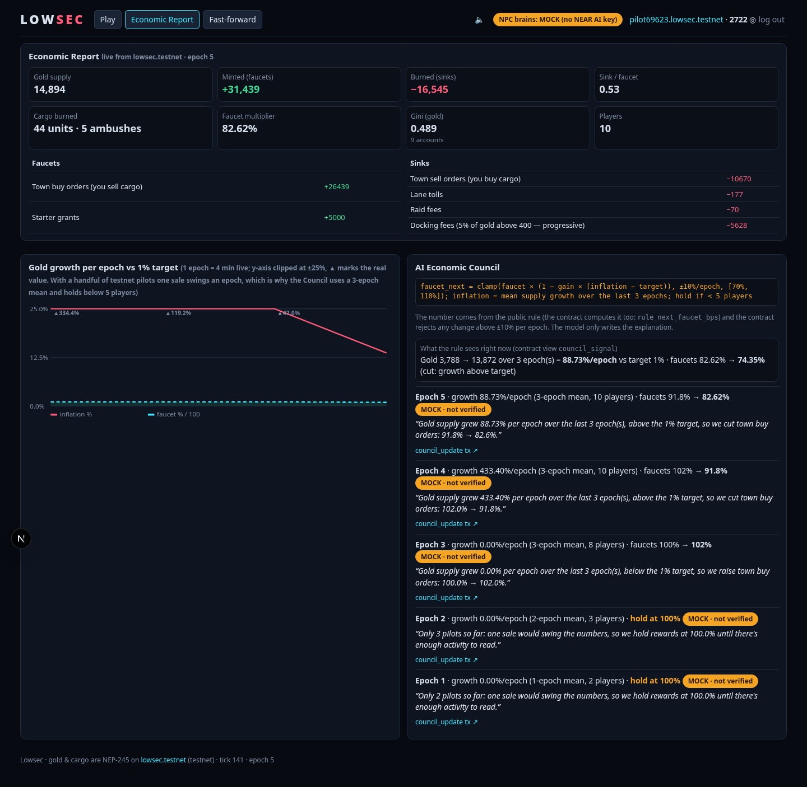

# Lowsec

**A mini EVE Frontier on NEAR whose economy corrects itself, and you can check how.** You haul cargo between 3 towns. The fast **Lowsec** lane gets raided by players and AI haulers, and cargo destroyed there is **burned**. An **AI Economic Council** steers gold inflation with one public rule, and the contract caps each change at ±10% per epoch. There's no token: gold and cargo are NEP-245 multi-tokens in a single contract, [`lowsec.testnet`](https://testnet.nearblocks.io/address/lowsec.testnet).

Built from scratch for the NEAR HACKATHON (tracks: Games With Real Economies; Agents; Swarms).


## Run it (one command)
```bash
pnpm i
pnpm dev        # Node server (relayer + AI haulers + Council) on :8787, game on http://localhost:3000
```
- It plays against the live testnet contract. The server reads its keys from `~/.near-credentials/testnet/` (see `.env.example`). Keys never go into the repo.
- **MOCK mode:** if `NEARAI_API_KEY` isn't set, the NPC and Council "brains" use a deterministic local policy. That is labelled **MOCK · not verified** everywhere: the header pill, every badge, the attestation file, and `signature_kind="mock"` on-chain. Set the key and the same code calls `z-ai/glm-5.3-flash` on NEAR AI Cloud (TEE).
- `node scripts/e2e.mjs` runs the whole loop in a headless browser (two pilots, a raider and a hauler) and refreshes every screenshot in [`docs/screenshots`](docs/screenshots).

## Try it in 3 minutes (do X → see Y)
| # | Do | You should see |
|---|---|---|
| 1 | Open http://localhost:3000, type a name, press **Play** | "Welcome name.lowsec.testnet — no wallet, no gas", 500 ◎ gold, a tx link. The account is a real sub-account with a function-call key created in your browser. No popups. |
| 2 | Follow the 3-step hint: **Buy** ore in Mina (where it is made, so cheapest) | The step ticks off, your NEP-245 ore balance goes up, and a meta-tx link appears (the relayer paid the gas) |
| 3 | Pick **Lowsec** to Forja, press **Depart** | Your convoy moves along the dashed red lane. The panel shows ambush chance 8%, or 20%+ when a raid is posted (☠×n) |
| 4 | Wait about 10 s | Either "Arrived … · docking fee N◎ burned", or the hero moment: an explosion, screen shake, **"AMBUSHED by …"** and "−N ⛏ BURNED". The 🔥 cargo-burned counter goes up, and the tx shows an `mt_burn` event with memo `ambush_destroyed` |
| 5 | Hover **Kestrel** or **Vex** on the map | Their in-character reasoning, a **MOCK · not verified** badge (or **TEE verified ✓** with a key), and a link to their `record_decision` tx |
| 6 | Check the right column | 📜 Contract of the day (progress bar), 🏆 richest pilots with gold gained this epoch, the activity feed |
| 7 | **Deposit from any chain** → Get quote | A real NEAR Intents 1Click quote (`dry: true`), e.g. "10 USDC on Base → 2.9 NEAR". It is labelled QUOTE ONLY and nothing executes |
| 8 | **Economic Report** tab | Live faucets and sinks (including docking fees), Gini, cargo burned, growth per epoch, and the Council panel with the exact inputs from the `council_signal` view (window, players, hold reason) |
| 9 | **Fast-forward** → Simulate 4 weeks | 120 simulated players: Council vs no Council vs v0.1 rules, plus the faucet multiplier the Council chose each day |

Expected terminal output for `pnpm sim --weeks 4` (seed 42, abridged):
```
  council : mean 2.24%  last-7-days 0.64%  mean |error| 2.38%  final supply 54,639
  baseline: mean 2.61%  last-7-days 0.30%  mean |error| 2.61%  final supply 60,206
  peak day: council 12.09% vs baseline 10.66%; final Gini council 0.145 vs baseline 0.147
  v0.1 rules (no Council, no docking fee): mean |error| 2.85%  peak 12.26%  Gini 0.182  final supply 74,355
```

## Screenshots
| | |
|---|---|
|  |  |
|  |  |
|  |  |
|  |  |

## NEAR features used (file:line)
| Feature | Where |
|---|---|
| NEP-245 multi-token (gold, ore, parts, fuel in one contract) | [contracts/lowsec/src/mt.rs:90](contracts/lowsec/src/mt.rs#L90), [contracts/lowsec/src/mt.rs:152](contracts/lowsec/src/mt.rs#L152) |
| NEP-297 events (`nep245` mt_mint / mt_burn / mt_transfer + `lowsec` game events) | [contracts/lowsec/src/events.rs:17](contracts/lowsec/src/events.rs#L17) |
| Cargo destroyed in an ambush is burned (`mt_burn`, memo `ambush_destroyed`) | [contracts/lowsec/src/lib.rs:388](contracts/lowsec/src/lib.rs#L388) |
| Sub-accounts: `name.lowsec.testnet` created by the contract | [contracts/lowsec/src/lib.rs:244](contracts/lowsec/src/lib.rs#L244) |
| Function-call access key with allowance, limited to game methods | [contracts/lowsec/src/lib.rs:252](contracts/lowsec/src/lib.rs#L252), [apps/server/src/setup-keys.ts:35](apps/server/src/setup-keys.ts#L35) |
| Key generated in the browser (never leaves it) | [apps/web/lib/near.ts:33](apps/web/lib/near.ts#L33) |
| NEP-366 meta-transactions: browser signs a DelegateAction | [apps/web/lib/near.ts:56](apps/web/lib/near.ts#L56) |
| Relayer pays gas, with a policy (target, sender, method, zero deposit, gas cap) | [apps/server/src/relayer.ts:21](apps/server/src/relayer.ts#L21), [apps/server/src/relayer.ts:48](apps/server/src/relayer.ts#L48) |
| Council bounded on-chain (±10%/epoch, [70%,110%], once per epoch) | [contracts/lowsec/src/lib.rs:453](contracts/lowsec/src/lib.rs#L453) |
| Public rule computed by the contract (inputs exposed) | [contracts/lowsec/src/lib.rs:539](contracts/lowsec/src/lib.rs#L539) |
| AI decisions anchored on-chain (payload hash + attestation hash + signature kind) | [contracts/lowsec/src/lib.rs:471](contracts/lowsec/src/lib.rs#L471) |
| NEAR AI Cloud TEE inference (`@nearai/inference-sdk`) + `verifyResponse` | [apps/server/src/nearai.ts:73](apps/server/src/nearai.ts#L73), [apps/server/src/nearai.ts:100](apps/server/src/nearai.ts#L100) |
| Clearly labelled MOCK provider when no key | [apps/server/src/nearai.ts:62](apps/server/src/nearai.ts#L62) |
| Progressive sink: docking fee on gold above 400 | [contracts/lowsec/src/lib.rs:371](contracts/lowsec/src/lib.rs#L371) |
| NEAR Intents 1Click quote, `dry: true` (quote only) | [apps/server/src/extras.ts:88](apps/server/src/extras.ts#L88) |
| Open agent API for external agents with their own NEAR account | [apps/server/src/index.ts:141](apps/server/src/index.ts#L141), [examples/external-agent.mjs:10](examples/external-agent.mjs#L10) |

Line numbers are as of the latest commit.

## Economy
| | |
|---|---|
| Faucets | NPC buy orders (selling cargo to a town), scaled by the Council's `faucet_bps`; a fixed 500 ◎ starter grant |
| Gold sinks | NPC sell orders (buying cargo), lane tolls (safe 12, Lowsec 3), raid fees (10% of the stake), **docking fee**: 5% of the gold you hold above 400, charged on every arrival |
| Item sinks | Cargo destroyed in Lowsec ambushes (`mt_burn`), town consumption (stocks revert to a goal) |
| Council rule | `faucet_next = clamp(faucet × (1 − 2 × (inflation − 1%)), ±10%/epoch, [70%, 110%])`. *inflation* is the mean gold-supply growth per epoch over the last 3 closed epochs. Below 5 players the rule **holds**, because one sale would swing the signal |
| Who decides | The contract computes the number (`council_signal`, `rule_next_faucet_bps`) and rejects anything outside the bound. The LLM only writes the explanation, and the attestation hash of that explanation is recorded on-chain |
| Rules | [`packages/sim/src/params.ts`](packages/sim/src/params.ts) + [`pricing.ts`](packages/sim/src/pricing.ts) + [`council.ts`](packages/sim/src/council.ts), mirrored in [`contracts/lowsec/src/rules.rs`](contracts/lowsec/src/rules.rs). A parity test runs the Rust code on vectors generated by the TS code |

### Does the Council help? (honest numbers, 8 seeds × 4 weeks)
`pnpm --filter @lowsec/sim sweep`. The baseline is v0.1 rules: no Council, no docking fee. MAE is the mean |daily inflation − 1%| from day 2 on.

| Config | MAE | Error vs baseline | MAE wins | Worst day ≤ baseline | Gini (avg) | Gini ≤ baseline |
|---|---|---|---|---|---|---|
| Baseline (no Council, no docking fee) | 2.79 pp | – | – | – | 0.181 | – |
| A. Council v0.1 (also scales the starter grant, no docking fee) | 2.14 pp | −23.3% | 8/8 | 7/8 | 0.252 | **0/8** |
| B. Docking fee only, no Council | 2.70 pp | −3.1% | 6/8 | 7/8 | 0.140 | 8/8 |
| **E. Council v0.2 + docking fee (default)** | **2.48 pp** | **−11.0%** | **8/8** | **8/8** | **0.137** | **8/8** |

Same-rules comparison (E vs B, i.e. switching only the Council on): MAE better on 8/8 seeds, worst day not worse on 7/8, Gini not worse on 4/8 (averages 0.137 vs 0.140, so a wash).

**Tradeoffs.**
- v0.1 cut inflation error the most (−23%), but it raised Gini on every seed: cutting the starter grant hits newcomers hardest.
- v0.2 keeps the starter grant fixed and adds a thematic progressive sink, the docking fee on wealth above 400. Now Council + sinks beat the do-nothing economy on error, worst day **and** Gini on 8/8 seeds. The price is about half of v0.1's error reduction.
- **Live testnet is not the 120-player economy.** With 2 AI haulers and a few pilots, arbitrage margins stay wide, so live gold growth per epoch is high and the Council sits near its 70% floor. The live chart is clipped (▲ marks the real value), and Fast-forward shows the populated economy.

## AI agents (Agents + Swarms)
- **Kestrel** (cautious merchant) and **Vex** (aggressive raider) are AI haulers. Each has its own sub-account and function-call key and goes through the same relayer as players. Every turn: options are priced with the contract's rules → model choice → `record_decision` (payload hash + attestation hash) → action.
- The **Council** acts once per epoch with its own function-call key (`council_update`, `record_decision`).
- **Bring your own agent:** any NEAR account can play directly, paying its own gas. `GET /api/agent/observe?account=you.testnet` returns your state, the priced options and the method signatures. The ~20-line [`examples/external-agent.mjs`](examples/external-agent.mjs) is a complete bot: `node examples/external-agent.mjs you.testnet`. Tested with `lowsec-agent-demo.testnet` (a plain faucet account): register → buy → start_haul → arrive → sell → a second haul, all signed by the agent itself.

## Testnet accounts and transactions
See [docs/DEPLOYMENTS.md](docs/DEPLOYMENTS.md) for every deploy and an example tx for each feature. Accounts: `lowsec.testnet` (contract), `lowsec-council.testnet`, `lowsec-relayer.testnet`, `hauler-1.lowsec.testnet` (Kestrel), `hauler-2.lowsec.testnet` (Vex), `lowsec-agent-demo.testnet` (external agent).

## Repo and tests
```
packages/sim       deterministic economy sim, CLI, sweep            pnpm test → 17 tests
contracts/lowsec   Rust contract (near-sdk 5.30.1)                   cargo test → 26 unit (incl. TS↔Rust parity) + 1 near-workspaces sandbox test
apps/server        Hono: relayer, onboarding, AI haulers, Council, open agent API, 1Click quote    8 tests
apps/web           Next.js 16 game UI (signs meta-txs in the browser, no wallet)
examples/          external-agent.mjs
scripts/           e2e.mjs (playwright), check-secrets.sh (gitleaks pre-commit), testnet-smoke.sh
```

## Hosting later (not deployed yet)
- **Web → Vercel**: root `apps/web`, set `LOWSEC_SERVER_URL=https://<server>` (all `/api/*` calls are rewritten to it).
- **Server → any Node host**: `pnpm --filter @lowsec/server start`. Keys go in as secrets (`RELAYER_PRIVATE_KEY`, `ONBOARDER_PRIVATE_KEY`, `COUNCIL_PRIVATE_KEY`, `HAULER_1_PRIVATE_KEY`, `HAULER_2_PRIVATE_KEY`, `NEARAI_API_KEY`). `DATA_DIR` needs a persistent volume for the attestation bundles.

## Built during the hackathon
- Everything in this repo was written from scratch between **Nov 12 and Nov 14, 2026**; the first commit is Nov 12. There's no pre-existing code.
- Libraries: near-sdk, near-workspaces, near-api-js, @nearai/inference-sdk, Hono, Next.js/React, vitest, playwright.
- The code was written with AI assistance.
- Known limitations:
  - The ambush roll uses `env::random_seed`, which validators could bias. That's fine for a testnet game, but not for real value.
  - The contract is testnet only. Its state was reset once for v0.2 (`reset_v2`); v0.1 transactions stay on the explorer.
  - Contract of the day and leaderboard are off-chain (server); no gold is minted for them.
  - The 1Click integration is quote-only.

## License
MIT
