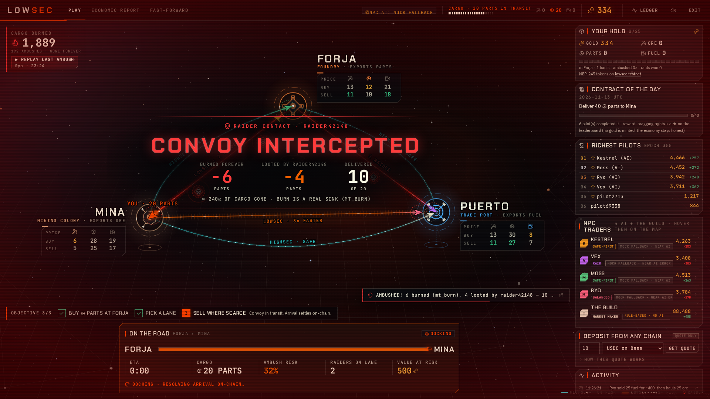
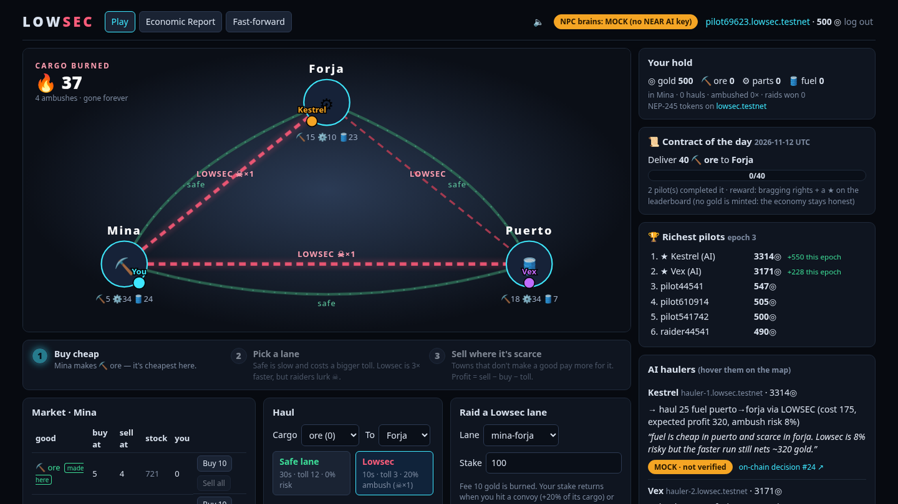
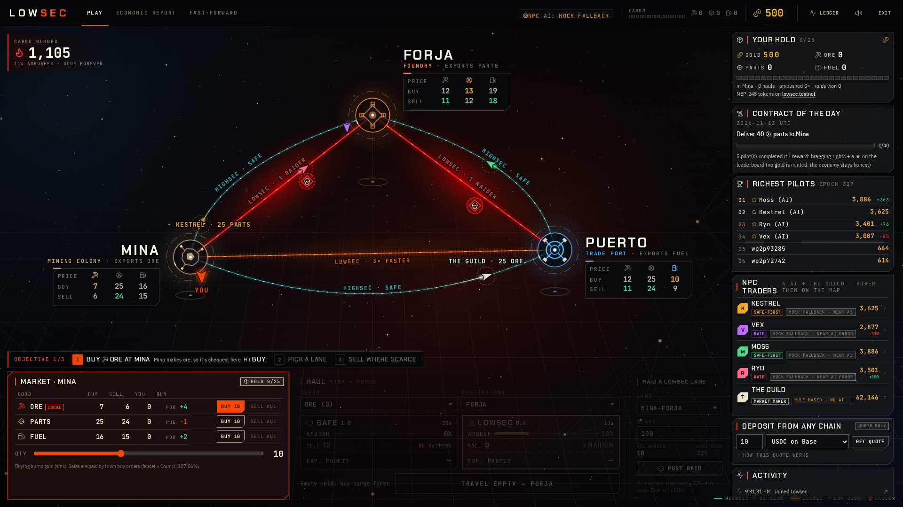
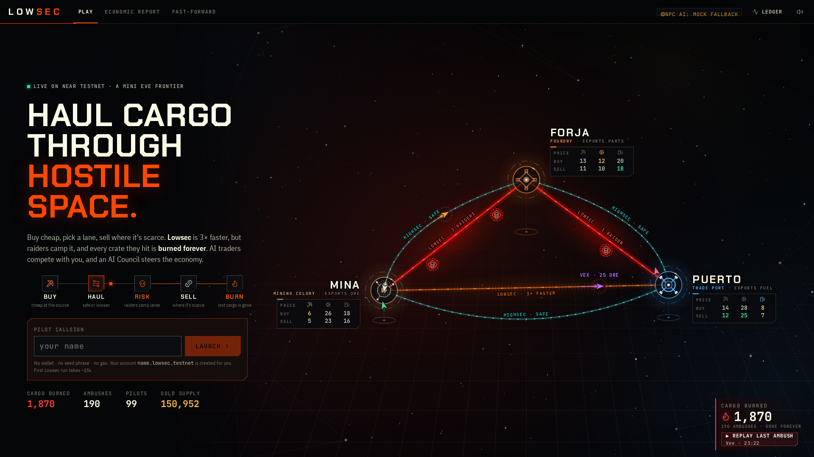
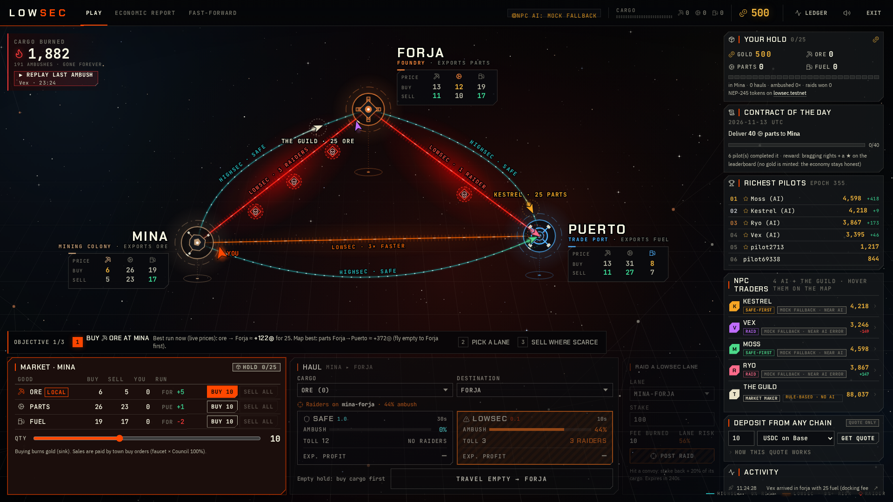
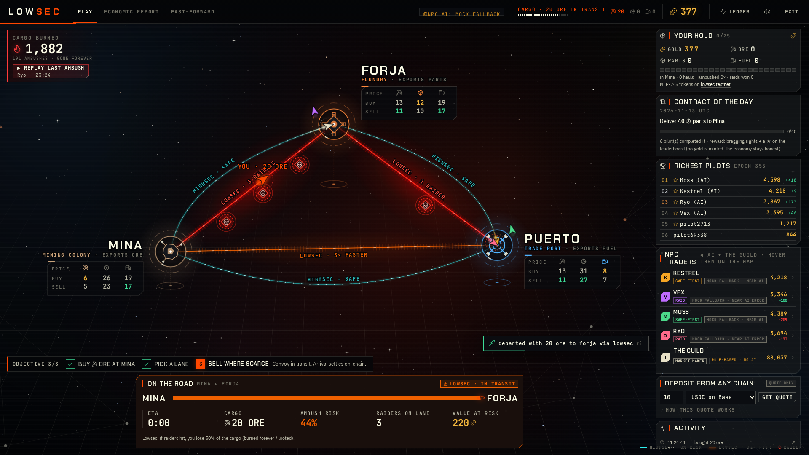
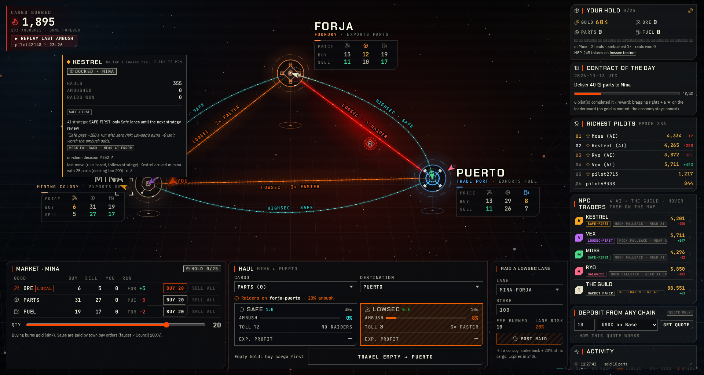
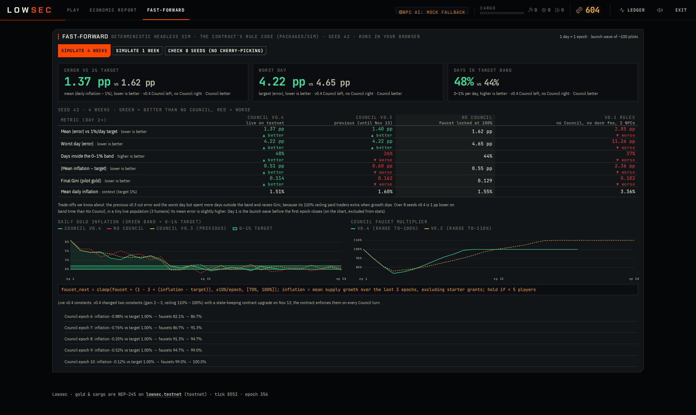
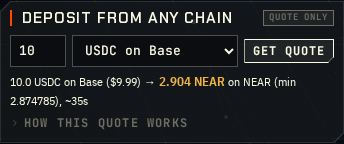

# Lowsec

**A mini EVE Frontier on NEAR whose economy corrects itself, and you can check how.** You haul cargo between 3 towns. The fast **Lowsec** lane gets raided by players and AI haulers, and cargo destroyed there is **burned**. An **AI Economic Council** steers gold inflation with one public rule, and the contract caps each change at ±10% per epoch. There's no token: gold and cargo are NEP-245 multi-tokens in a single contract, [`lowsec.testnet`](https://testnet.nearblocks.io/address/lowsec.testnet).

Built from scratch for the NEAR HACKATHON (tracks: Games With Real Economies; Agents; Swarms).

**Repo:** https://github.com/salazarsebas/lowsec · **Demo video (silent cut, 1:58, 1920x1080; voiceover script in [demo/VOICEOVER.md](demo/VOICEOVER.md)):** [demo/lowsec-demo-silent.mp4](demo/lowsec-demo-silent.mp4). It shows a real testnet ambush and ends on that ambush tx in a public explorer (one 6 s chain wait is cut and marked on screen; sped-up clips say so); the AI tooltip says MOCK fallback because the NEAR AI account has no credits yet (see "TEE status" below).

[](demo/lowsec-demo-silent.mp4)

▶ **[Watch the demo video (MP4, 1920x1080)](demo/lowsec-demo-silent.mp4)**

**The look:** a full-screen star map with glass HUD panels, in the visual language of EVE Frontier and Elite Dangerous: EVE security colours for lane danger, one signal orange for the next action, sci-fi type, sound effects, and an ambush you feel (hit-stop, shockwave, "CONVOY INTERCEPTED" with the loss counted up). Design system: [docs/DESIGN.md](docs/DESIGN.md).

| Before (v0.3) | After (redesign) |
|---|---|
|  |  |

## Run it (one command)
```bash
pnpm i
pnpm dev           # Node server (relayer + AI haulers + Council) on :8787, game on http://localhost:3000
pnpm dev:observe   # read-only UI against the live testnet contract — no relayer or NPC keys needed
```
- `pnpm dev` plays against the live testnet contract. The server reads its keys from `~/.near-credentials/testnet/` (see `.env.example`). Keys never go into the repo.
- `pnpm dev:observe` is the no-keys path for judges and reviewers: same UI at http://localhost:3000, same on-chain economy, but the process never signs. Join / buy / depart are disabled; you can watch the map, NPCs, report and feed.
- **MOCK mode:** if `NEARAI_API_KEY` isn't set, the NPC and Council "brains" use a deterministic local policy. That is labelled **MOCK · not verified** everywhere: the header pill, every badge, the attestation file, and `signature_kind="mock"` on-chain. Set the key and the same code calls `z-ai/glm-5.3-flash` on NEAR AI Cloud (TEE). If a NEAR AI call fails, that decision falls back to the local policy and is labelled **MOCK fallback · NEAR AI error** (header pill + badge show the error); nothing is ever marked verified without a `provider_tee` signature.
- **TEE status today (2026-11-13), stated plainly:** with our key, `pnpm --filter @lowsec/server tee:check` passes step 1: the Gateway attestation and the `z-ai/glm-5.3-flash` model TEE report (TCB UpToDate, GPU evidence) verify. Inference then returns **402 "No spending limit configured"**: the NEAR AI account has no credits yet. So every decision on-chain so far is `signature_kind="mock"`, and the demo video shows MOCK. When credits are enabled, the running server switches to verified decisions with no code change.
- `node scripts/e2e.mjs` runs the whole loop in a headless browser (two pilots, a raider and a hauler) and refreshes every screenshot in [`docs/screenshots`](docs/screenshots).

## Try it in 3 minutes (do X → see Y)
| # | Do | You should see |
|---|---|---|
| 1 | Open http://localhost:3000, type a name, press **Play** | "Welcome name.lowsec.testnet — no wallet, no gas", 500 ◎ gold, a tx link. The account is a real sub-account with a function-call key created in your browser. No popups. |
| 2 | Follow the 3-step hint: **Buy** ore in Mina (where it is made, so cheapest) | The step ticks off, your NEP-245 ore balance goes up, and a meta-tx link appears (the relayer paid the gas) |
| 3 | Pick **Lowsec** to Forja, press **Depart** | Your convoy (an orange chevron with a trail) moves along the glowing red Lowsec lane. Hover any lane first to see its ambush risk, ETA and expected profit; risk is 8%, or 20%+ when raiders are posted (red blips on the lane) |
| 4 | Wait about 10 s | Either "Arrived … · docking fee N◎ burned", or the hero moment: a flash and shockwave on the map, screen shake, a full-screen **"CONVOY INTERCEPTED"** with burned / looted / delivered counted up (click or wait 2.5 s to dismiss). The cargo-burned counter goes up, and the tx shows an `mt_burn` event with memo `ambush_destroyed` |
| 5 | Hover an AI trader (**Kestrel**, **Vex**, **Moss**, **Ryo**) on the map | Its current AI strategy with in-character reasoning, the latest rule-based move, a **MOCK · not verified** badge (or **TEE verified ✓** with a key), and a link to their `record_decision` tx |
| 6 | Check the right column | Your hold, Contract of the day (progress bar), richest pilots with gold gained this epoch, the AI traders with their strategy and AI seal, the activity feed |
| 7 | **Deposit from any chain** → Get quote | A real NEAR Intents 1Click quote (`dry: true`), e.g. "10 USDC on Base → 2.9 NEAR". It is labelled QUOTE ONLY and nothing executes |
| 8 | **Economic Report** tab | Live faucets and sinks (including docking fees), Gini, cargo burned, growth per epoch, and the Council panel with the exact inputs from the `council_signal` view (window, players, hold reason) |
| 9 | **Fast-forward** → Simulate 4 weeks | 120 simulated players: Council vs no Council vs v0.1 rules, plus the faucet multiplier the Council chose each day |

Expected terminal output for `pnpm sim --weeks 4` (seed 42, abridged):
```
  council : mean 2.24%  last-7-days 0.64%  mean |error| 2.38%  final supply 54,639
  baseline: mean 2.61%  last-7-days 0.30%  mean |error| 2.61%  final supply 60,206
  peak day: council 12.09% vs baseline 10.66%; final Gini council 0.145 vs baseline 0.147
  v0.1 rules (no Council, no docking fee): mean |error| 2.85%  peak 12.26%  Gini 0.182  final supply 74,355
```

## Screenshots
| | |
|---|---|
|  |  |
|  |  |
|  |  |
|  |  |

## NEAR features used (file:line)
| Feature | Where |
|---|---|
| NEP-245 multi-token (gold, ore, parts, fuel in one contract) | [contracts/lowsec/src/mt.rs:90](contracts/lowsec/src/mt.rs#L90), [contracts/lowsec/src/mt.rs:152](contracts/lowsec/src/mt.rs#L152) |
| NEP-297 events (`nep245` mt_mint / mt_burn / mt_transfer + `lowsec` game events) | [contracts/lowsec/src/events.rs:17](contracts/lowsec/src/events.rs#L17) |
| Cargo destroyed in an ambush is burned (`mt_burn`, memo `ambush_destroyed`) | [contracts/lowsec/src/lib.rs:428](contracts/lowsec/src/lib.rs#L428) |
| Sub-accounts: `name.lowsec.testnet` created by the contract | [contracts/lowsec/src/lib.rs:261](contracts/lowsec/src/lib.rs#L261) |
| Function-call access key with allowance, limited to game methods | [contracts/lowsec/src/lib.rs:269](contracts/lowsec/src/lib.rs#L269), [apps/server/src/setup-keys.ts:36](apps/server/src/setup-keys.ts#L36) |
| Key generated in the browser (never leaves it) | [apps/web/lib/near.ts:37](apps/web/lib/near.ts#L37) |
| NEP-366 meta-transactions: browser signs a DelegateAction | [apps/web/lib/near.ts:60](apps/web/lib/near.ts#L60) |
| Relayer pays gas, with a policy (target, sender, method, zero deposit, gas cap) | [apps/server/src/relayer.ts:42](apps/server/src/relayer.ts#L42), [apps/server/src/relayer.ts:71](apps/server/src/relayer.ts#L71) |
| Council bounded on-chain (±10%/epoch, [70%,100%] in v0.4, once per epoch) | [contracts/lowsec/src/lib.rs:493](contracts/lowsec/src/lib.rs#L493) |
| Council v0.4 retune with state kept: owner-only, bounded `set_council_params` (ceiling ≤ 110%, gain 1–10) | [contracts/lowsec/src/lib.rs:569](contracts/lowsec/src/lib.rs#L569) |
| Public rule computed by the contract (inputs exposed) | [contracts/lowsec/src/lib.rs:620](contracts/lowsec/src/lib.rs#L620) |
| AI decisions anchored on-chain (payload hash + attestation hash + signature kind) | [contracts/lowsec/src/lib.rs:511](contracts/lowsec/src/lib.rs#L511) |
| NEAR AI Cloud TEE inference (`@nearai/inference-sdk`) + `verifyResponse` | [apps/server/src/nearai.ts:126](apps/server/src/nearai.ts#L126), [apps/server/src/nearai.ts:139](apps/server/src/nearai.ts#L139) |
| One-command TEE check: Gateway + model attestation, then a `provider_tee` signature | [apps/server/src/tee-check.ts:22](apps/server/src/tee-check.ts#L22) |
| Clearly labelled MOCK provider (no key) and MOCK fallback (NEAR AI error) | [apps/server/src/nearai.ts:83](apps/server/src/nearai.ts#L83), [apps/server/src/nearai.ts:128](apps/server/src/nearai.ts#L128) |
| Council explanation must match the rule's direction, or the rule text is used | [apps/server/src/agents/council.ts:117](apps/server/src/agents/council.ts#L117) |
| Progressive sink: docking fee on gold above 400 | [contracts/lowsec/src/lib.rs:411](contracts/lowsec/src/lib.rs#L411) |
| NEAR Intents 1Click quote, `dry: true` (quote only) | [apps/server/src/extras.ts:88](apps/server/src/extras.ts#L88) |
| Open agent API for external agents with their own NEAR account | [apps/server/src/index.ts:181](apps/server/src/index.ts#L181), [examples/external-agent.mjs:10](examples/external-agent.mjs#L10) |

Line numbers are as of the latest commit.

## Economy
| | |
|---|---|
| Faucets | NPC buy orders (selling cargo to a town), scaled by the Council's `faucet_bps`; a fixed 500 ◎ starter grant. The Guild's 30,000 ◎ float is minted **once, in the genesis epoch** (`seed_guild`, owner-only), so it is genesis supply, never inflation |
| Gold sinks | NPC sell orders (buying cargo), lane tolls (safe 12, Lowsec 3), raid fees (10% of the stake), **docking fee**: 5% of the gold you hold above 400, charged on every arrival (the Guild's float is exempt) |
| Item sinks | Cargo destroyed in Lowsec ambushes (`mt_burn`), town consumption (stocks revert to a goal) |
| Competition (v0.3) | **4 AI traders** (Kestrel, Vex, Moss, Ryo) + **the Guild**, a rule-based market maker (no AI) that restocks the scarcest town over Safe lanes. Every NPC takes a turn about every 10 s; a turn is one `turn` call (sell all, buy, depart). Traders see cargo already en route, so they don't all dump into one town |
| Council rule (v0.4, live) | `faucet_next = clamp(faucet × (1 − 3 × (inflation − 1%)), ±10%/epoch, [70%, 100%])`. Live on `lowsec.testnet` since 2026-11-13 22:51 CET via a state-keeping upgrade + owner-only `set_council_params` ([tx](https://testnet.nearblocks.io/txns/4M3eDULyukMe1TEAXTeTLXm4rpsoM4zGwaX9vPUnbxj5)); v0.3 was gain 2, [70%, 110%]. The contract's `economy().council_rule` prints the live constants. *inflation* is the mean gold-supply growth per epoch over the last 3 closed epochs. Below 5 players the rule **holds**, because one sale would swing the signal |
| Who decides | The contract computes the number (`council_signal`, `rule_next_faucet_bps`) and rejects anything outside the bound. The LLM only writes the explanation, and the attestation hash of that explanation is recorded on-chain |
| Rules | [`packages/sim/src/params.ts`](packages/sim/src/params.ts) + [`pricing.ts`](packages/sim/src/pricing.ts) + [`council.ts`](packages/sim/src/council.ts), mirrored in [`contracts/lowsec/src/rules.rs`](contracts/lowsec/src/rules.rs). A parity test runs the Rust code on vectors generated by the TS code |

### Why v0.2 looked broken live, and what v0.3 changed
Live v0.2 showed ~9%/epoch growth with the Council stuck at its 70% floor. The sim reproduced it once it modelled what was actually running: **2 NPCs taking one action per 20 s step (a trade every ~4 ticks)**. Between their trades, towns restocked, so every haul earned a full arbitrage margin. That printed gold faster than the docking fee could burn it, and with only ~5,000–15,000 ◎ in circulation one haul moved supply by several percent.

v0.3 fixes the cause, not the symptom: more competition (4 AI traders + the Guild, all trading every turn) closes margins, and the Guild's float makes supply big enough that one haul is a rounding error. No price rule changed and the contract's pricing is the same; the new code is `seed_guild`, the docking-fee exemption for the Guild, and `turn` (one call per NPC turn, because function-call keys can't batch actions).

### Honest numbers (8 seeds × 4 weeks, `pnpm --filter @lowsec/sim sweep`)
Mean abs error is the mean |epoch inflation − 1%| from epoch 2 on (epoch 1 is the launch spike). Band = −1%…+3% per epoch. Gini is over pilots (humans + NPC traders); the Guild's float is excluded because it is an institution, not a player hoard. Since v0.3.1 the Council's signal **excludes starter grants** (new pilots are onboarding, not inflation of existing holdings); the columns above still report total supply growth, grants included.

**Launch population** (40 players + a 10-day wave, ~100 pilots):

| config | mean infl./epoch | mean abs error vs 1% | worst epoch | epochs in band | Gini (pilots) | final faucet | epochs at 70% floor |
|---|---|---|---|---|---|---|---|
| v0.1 rules (2 NPCs, no Council, no dock fee) | 3.37% | 2.79 pp | 13.09% | 67% | 0.181 | 100% (fixed) | — |
| v0.2 (2 NPCs, Council + dock fee) | 2.81% | 2.43 pp | 11.16% | 64% | 0.141 | 110.00% | 0% |
| v0.3 NPCs, no Council | 1.50% | 1.57 pp | 5.46% | 70% | 0.138 | 100% (fixed) | — |
| v0.3 NPCs + Council v0.3 (previous) | 1.61% | 1.36 pp | 5.24% | 71% | 0.143 | 110.00% | 0% |
| v0.3 NPCs + **Council v0.4 (live)** | 1.45% | 1.48 pp | 5.20% | 71% | 0.133 | 100.00% | 0% |

**Live population** (3 humans who act now and then, no wave: what a judge sees on testnet):

| config | mean infl./epoch | mean abs error vs 1% | worst epoch | epochs in band | Gini (pilots) | final faucet | epochs at 70% floor |
|---|---|---|---|---|---|---|---|
| v0.1 rules (2 NPCs, no Council, no dock fee) | 7.11% | 6.11 pp | 26.78% | 7% | 0.397 | 100% (fixed) | — |
| v0.2 (2 NPCs, Council + dock fee) | -0.45% | 10.08 pp | 26.83% | 12% | 0.100 | 90.24% | 1% |
| v0.2 as it ran live (2 NPCs acting every ~4 ticks) | 2.66% | 4.67 pp | 45.19% | 38% | 0.035 | 78.23% | 11% |
| v0.3 NPCs, no Council | 1.11% | 0.99 pp | 4.94% | 93% | 0.069 | 100% (fixed) | — |
| v0.3 NPCs + Council v0.3 (previous) | 0.59% | 1.15 pp | 3.51% | 82% | 0.080 | 89.88% | 0% |
| v0.3 NPCs + **Council v0.4 (live)** | 0.70% | 1.09 pp | 3.64% | 83% | 0.074 | 91.84% | 0% |

**Tradeoffs, plainly.**
- Why v0.4 (gain 3, ceiling 100%): the 110% ceiling let the Council pay traders *more* than list price whenever growth dipped, which raised Gini. Capped at 100% the Council can only tighten. On this sweep's metrics v0.4 lowers Gini in both populations (0.133 vs 0.143; 0.074 vs 0.080), lowers mean inflation in the launch wave (1.45% vs 1.61%) and lowers mean error live (1.09 vs 1.15 pp), but **mean error in the launch wave is higher** (1.48 vs 1.36 pp). On the Fast-forward page's daily metrics (0–1% band, seed 42) v0.4 beats v0.3 on four of five and ties the worst day; over 8 seeds it is 1 pp lower on band time than no Council. Both views are in the repo (`pnpm --filter @lowsec/sim sweep`, `pnpm sim --weeks 4`).
- The big win is the NPC cast, not the Council: in the live population v0.3 *without* a Council already lands 93% of epochs in band. With the Council, the worst epoch improves (3.5% vs 4.9%), but mean error is slightly worse (1.15 vs 0.99 pp) and Gini slightly higher (0.080 vs 0.069), because it keeps nudging a market that is already near target. In the launch population the Council helps on every metric except Gini (0.143 vs 0.138).
- Why grants are excluded (v0.3.1): live, 4 pilots joining in one epoch added +2,000 ◎ of grants (+4.5% supply), and the Council cut the faucet down to its 70% floor for it, although trading alone was near 1%. With the old signal the launch sweep spent 32% of epochs at the floor; with grants excluded it spends 0%. The cost, plainly: in the launch wave the Council now ends at its 110% ceiling and mean total inflation rises (1.61% vs 1.27%), because grant-driven growth is no longer something the faucet fights. Mean abs error still improves (1.36 vs 1.47 pp). The live population is unchanged (few grants).
- The Guild's 30,000 ◎ float is disclosed everywhere (Report ledger, README, `guild()` view). It is genesis supply, it pays tolls like anyone, and it only uses Safe lanes, so it never feeds raiders.

## AI agents (Agents + Swarms)
- **4 AI traders**, each with its own sub-account and function-call key, going through the same gasless relayer as players: **Kestrel** (cautious), **Vex** (smuggler, raids), **Moss** (steady), **Ryo** (opportunist, raids). About once per epoch (4 min) each one asks the model for a **strategy**: Safe-first, balanced, Lowsec-first, or raid. The prompt holds options priced with the contract's rules, the reply is verified, and `record_decision` stores the payload hash and attestation hash on-chain. In between, **moves are rule-based** and follow that strategy: one `turn` call, no LLM. That keeps TEE inference to ~60 calls per hour for the whole swarm.
- **The Guild** (`guild.lowsec.testnet`) is a rule-based market maker, labelled "RULE-BASED · no AI" in the UI.
- The **Council** acts once per epoch with its own function-call key (`council_update`, `record_decision`).
- To save testnet gas, NPCs and Council **pause when nobody has polled the API for 15 min** (`AGENTS_IDLE_PAUSE_MS`, 0 = never). Idle epochs merge on-chain into one record.
- **Bring your own agent:** any NEAR account can play directly, paying its own gas. `GET /api/agent/observe?account=you.testnet` returns your state, the priced options and the method signatures. The 21-line [`examples/external-agent.mjs`](examples/external-agent.mjs) is a complete bot: `node examples/external-agent.mjs you.testnet`. Tested with `lowsec-agent-demo.testnet` (a plain faucet account), signing its own transactions.

## Testnet accounts and transactions
See [docs/DEPLOYMENTS.md](docs/DEPLOYMENTS.md) for every deploy and an example tx for each feature. Accounts: `lowsec.testnet` (contract), `lowsec-council.testnet`, `lowsec-relayer.testnet`, `hauler-1..4.lowsec.testnet` (Kestrel, Vex, Moss, Ryo), `guild.lowsec.testnet` (the Guild), `lowsec-agent-demo.testnet` (external agent).

UI design system (palette, type, components, sound, credits): [docs/DESIGN.md](docs/DESIGN.md).

## Repo and tests
```
packages/sim       deterministic economy sim, CLI, sweep            pnpm test → 20 tests
contracts/lowsec   Rust contract (near-sdk 5.30.1)                   cargo test → 36 unit (incl. TS↔Rust parity) + 1 near-workspaces sandbox test
apps/server        Hono: relayer, onboarding, AI haulers, Council, open agent API, 1Click quote    25 tests
apps/web           Next.js 16 game UI (signs meta-txs in the browser, no wallet)
examples/          external-agent.mjs
scripts/           e2e.mjs (playwright), check-secrets.sh (gitleaks pre-commit), testnet-smoke.sh,
                   readme-lines.mjs (regenerates the file:line links below; --check fails if stale), upgrade-v04.mjs
demo/              record.mjs → assemble.mjs → make-voiceover.mjs (silent video, timeline.json, VOICEOVER.md/.es.md)
```

## Hosting later (not deployed yet)
- **Web → Vercel**: root `apps/web`, set `LOWSEC_SERVER_URL=https://<server>` (all `/api/*` calls are rewritten to it).
- **Server → any Node host**: `pnpm --filter @lowsec/server start`. Keys go in as secrets (`RELAYER_PRIVATE_KEY`, `ONBOARDER_PRIVATE_KEY`, `COUNCIL_PRIVATE_KEY`, `HAULER_1_PRIVATE_KEY`, `HAULER_2_PRIVATE_KEY`, `NEARAI_API_KEY`). `DATA_DIR` needs a persistent volume for the attestation bundles.

## Built during the hackathon
- Everything in this repo was written from scratch between **Nov 12 and Nov 14, 2026**; the first commit is Nov 12. There's no pre-existing code.
- Libraries: near-sdk, near-workspaces, near-api-js, @nearai/inference-sdk, Hono, Next.js/React, vitest, playwright.
- The code was written with AI assistance.
- Known limitations:
  - The ambush roll uses `env::random_seed`, which validators could bias. That's fine for a testnet game, but not for real value.
  - The contract is testnet only. Its state was reset once for v0.2 (`reset_v2`); v0.1 transactions stay on the explorer.
  - Contract of the day and leaderboard are off-chain (server); no gold is minted for them.
  - The 1Click integration is quote-only.

## License
MIT
