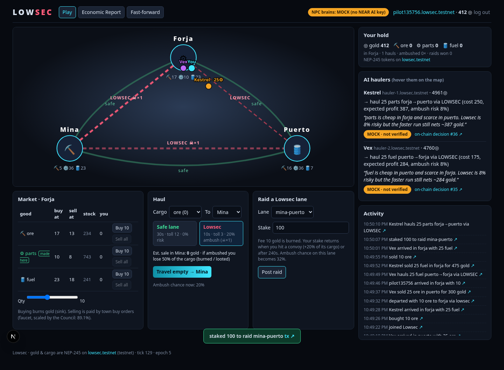

# Lowsec

A mini EVE Frontier on NEAR. Haul cargo between 3 towns. The fast **Lowsec** lane can be raided by players and AI haulers, and destroyed cargo is **burned**. An **AI Economic Council** keeps gold inflation in check with one public rule, and the contract caps every change at ±10% per epoch. There's no token: gold and cargo are NEP-245 multi-tokens on `lowsec.testnet`.

Built from scratch for the NEAR HACKATHON (track: Games With Real Economies; also Agents, Swarms).



## Run it locally (one command)
```bash
pnpm i
pnpm dev            # Node server (relayer + AI haulers + Council) on :8787, Next.js game on http://localhost:3000
```
The testnet contract is already deployed. To use your own accounts, copy `.env.example` to `.env`. The server needs the relayer key in `~/.near-credentials/testnet/` and the function-call keys from `pnpm setup-keys`. Keys never go in the repo.

Then open http://localhost:3000, type a name and press Play. That's all.

| What you do | What happens on NEAR |
|---|---|
| Type a name | Your browser makes a keypair. The contract creates `name.lowsec.testnet` with a **function-call key** limited to game methods, then `register` mints a starter grant (NEP-245 `mt_mint`). No wallet, no seed phrase, no gas. |
| Buy / sell / haul / raid | The browser signs a **NEP-366 DelegateAction**. Our relayer wraps it and pays the gas, after checking the target contract, the sender, the method and that the deposit is 0. |
| Haul via Lowsec | It's 3× faster with a 4× smaller toll. On `arrive`, the contract rolls an ambush: lost cargo is `mt_burn`ed (memo `ambush_destroyed`), some of it goes to the raider, and the raid stake is returned. |
| Hover Kestrel / Vex | You see their reasoning, the badge, and a link to the `record_decision` entry (payload hash + attestation hash) stored on-chain. |
| Economic Report tab | Live faucets and sinks, Gini, cargo burned, inflation per epoch, and the Council log. All of it is read from the contract's `economy` / `epochs` / `decisions` views. |
| Fast-forward tab | Runs the deterministic sim with the same rules as the contract (`packages/sim`, parity-tested against Rust) for 1 or 4 weeks with 120 players: Council vs no Council. |

Headless check of the whole loop, which also regenerates the screenshots: `node scripts/e2e.mjs` (needs `pnpm dev` running). The screenshots are in [docs/screenshots](docs/screenshots).

## AI: NEAR AI Cloud (TEE) or clearly labelled MOCK
`apps/server/src/nearai.ts` puts every model call behind one interface, `InferenceProvider`:
- With `NEARAI_API_KEY` set, it uses `z-ai/glm-5.3-flash` on NEAR AI Cloud through `@nearai/inference-sdk`. Each completion goes through `verifyResponse(id)`, and the verification bundle is saved under `data/attestations/<sha256>.json` (served at `/api/attestations/<hash>`). Its sha256 is written on-chain with `record_decision(kind, payload_hash, attestation_hash, model, signature_kind)` before the agent acts. The UI shows **TEE verified ✓** only when `signatureKind === "provider_tee"` and verification passed.
- Without the key, it uses a deterministic local policy. Everything is labelled **MOCK · not verified**: the header pill, every badge, the attestation bundle, and the `signature_kind="mock"` field on-chain.

The two NPC haulers are **Kestrel** (cautious merchant) and **Vex** (aggressive raider). Each runs as its own sub-account with its own function-call key and sends meta-txs through the same relayer as players. The **Council** doesn't pick the number itself. The contract computes the rule (`rule_next_faucet_bps`), rejects any change bigger than ±10% per epoch, and accepts updates only from the council account. The model only writes the rationale, and that rationale is hashed on-chain.

## Economy in one screen
| | |
|---|---|
| Faucets | NPC buy orders (selling cargo to a town) and the starter grant. Both are scaled by the Council's `faucet_bps` |
| Gold sinks | NPC sell orders (buying cargo), lane tolls, raid fees |
| Item sinks | Cargo destroyed in Lowsec ambushes (`mt_burn`), town consumption |
| Council rule | `faucet_next = clamp(faucet × (1 − gain × (inflation − target)), ±10%/epoch, [70%, 110%])`, target 1%/day, gain 2 |
| Rules | [`packages/sim/src/params.ts`](packages/sim/src/params.ts) + [`pricing.ts`](packages/sim/src/pricing.ts), mirrored in [`contracts/lowsec/src/rules.rs`](contracts/lowsec/src/rules.rs) (shared test vectors) |

### Does the Council help? (honest numbers)
`pnpm sim --weeks 4` (seed 42, 120 players, launch wave in week 1):

| | Council | No Council |
|---|---|---|
| Mean daily inflation (day 2+) | **2.26%** | 3.36% |
| Mean abs. error vs 1% target | **2.25 pp** | 2.85 pp |
| Final gold supply | **55,807** | 74,355 |
| Worst single day | 14.72% | **12.26%** |
| Final Gini (gold) | 0.242 | **0.182** |

**Tradeoff.** Across 8 seeds the Council beats the baseline on mean error every time (8/8, about 23% less error on average). But it **raises Gini** in all 8, and the worst day is not worse in 7 of 8. The reason: cutting faucets (NPC bids and the starter grant) hits newcomers and small traders hardest, while established haulers have already banked their gold. I tried these quick fixes in the sim (all of them are params in `params.ts`):
- EMA smoothing of the inflation signal (`councilSmoothingBps=5000`): about the same error reduction, Gini still worse.
- Not scaling the starter grant (`councilScalesGrant=false`): Gini no worse in 4 of 8 seeds, but error reduction falls to about 6%.
- The same plus `councilMinFaucetBps=8000`: Gini OK in 6 of 8 seeds and worst day OK in 6 of 8, with only about 7% error reduction.

None of these is a cheap fix that keeps both effects, so the default stays tuned for inflation control and the tradeoff is stated here. A progressive sink (a toll that grows with wallet size) is the next thing to try.

## Repo
```
packages/sim       deterministic economy sim + CLI (pnpm sim --weeks 4)       14 tests
contracts/lowsec   Rust contract, near-sdk 5.30.1, NEP-245 + NEP-297 events   21 unit + sandbox integration test
apps/server        Hono: relayer (NEP-366), onboarding, AI haulers, Council   8 tests
apps/web           Next.js 16 game UI (no wallet; signs meta-txs in-browser)
scripts/           e2e.mjs (playwright), check-secrets.sh (gitleaks pre-commit), testnet-smoke.sh
docs/              DEPLOYMENTS.md (accounts + tx links), screenshots/
```
```bash
pnpm test                                   # sim + server
cd contracts/lowsec && cargo test           # unit + parity + near-workspaces sandbox
```

## Hosting later (not deployed yet)
- **Web → Vercel**: root `apps/web`, env `LOWSEC_SERVER_URL=https://<server>` (all `/api/*` calls are rewritten to it), `NEXT_PUBLIC_CONTRACT_ID`.
- **Server → any Node host** (Railway/Fly/Render): `pnpm --filter @lowsec/server start`, keys as secrets (`RELAYER_PRIVATE_KEY`, `ONBOARDER_PRIVATE_KEY`, `COUNCIL_PRIVATE_KEY`, `HAULER_1_PRIVATE_KEY`, `HAULER_2_PRIVATE_KEY`, `NEARAI_API_KEY`), and a persistent volume for `DATA_DIR` (attestation bundles).

## License
MIT
